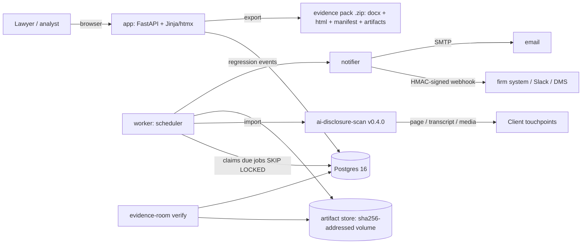

# Implementation plan: ai-act-evidence-room

Read `CLAUDE.md` first. Work through the milestones in order. Tick each box only when its acceptance checks pass.

## The problem, in one paragraph

Article 50 of the EU AI Act has applied since 2 August 2026 (the 50(2) marking duty for systems already on the market follows on 2 December 2026). Law firms advising on it need to show **what a client's chatbot, pages and AI-generated media actually did on a given date**, keep that evidence intact, and see when a fixed issue comes back. Today that's done with screenshots in email threads. This tool runs the open-source `ai-disclosure-scan` on a schedule for each client matter, stores hashed evidence, lets a lawyer confirm or override each finding with reasons, alerts on regressions, and exports a dated evidence pack.

## Architecture



## Data model (Postgres)

| Table | Key columns | Notes |
|---|---|---|
| `users` | id, email, name, role (`lawyer`/`analyst`/`admin`), password_hash | argon2; session cookie auth; single-firm deployment |
| `clients` | id, name, notes | fictional in demo |
| `matters` | id, client_id, title, status, retention_days, opened_at | |
| `touchpoints` | id, matter_id, kind (`page`/`transcripts`/`media`), target, party_role (`provider`/`deployer`), options jsonb (e.g. `browser`, `ui_notice`), schedule (`daily`/`weekly`/`manual`), next_run_at, active | |
| `scans` | id, touchpoint_id, started_at, finished_at, scanner_version, status (`queued`/`running`/`done`/`error`), error, triggered_by | |
| `artifacts` | id, scan_id, kind (`html`/`screenshot`/`transcript`/`media`/`report_json`), sha256, bytes, path, captured_at, purged_at | file stored at `store/ab/cd/<sha256>` |
| `findings` | id, scan_id, rule_id, paragraph (e.g. `50(1)`), status, detail, evidence, location, basis jsonb, fingerprint | immutable (trigger) |
| `reviews` | id, finding_id, reviewer_id, decision (`confirm`/`override_pass`/`override_gap`/`not_applicable`/`needs_client_input`), reason, created_at | append-only; reason required unless `confirm` |
| `audit_log` | id, at, actor, action, entity, entity_id, payload jsonb, prev_hash, hash | hash = sha256(prev_hash ‖ canonical JSON); UPDATE/DELETE rejected by trigger |
| `webhooks` | id, url, secret, events text[], active | |
| `deliveries` | id, webhook_id, event, payload jsonb, attempt, status_code, next_attempt_at, delivered_at | retries with exponential backoff |

**Fingerprint** = sha256(touchpoint_id ‖ rule_id ‖ normalised location). It lets two scans of the same touchpoint be compared finding by finding.

**SQL views in `sql/`** (show them in the README):
- `v_latest_scan`: the latest finished scan per touchpoint
- `v_effective_findings`: each finding with its latest review applied (machine status, lawyer decision, effective status)
- `v_regressions`: fingerprints that were PASS or absent in the previous scan and are GAP now, plus resolved ones
- `v_matter_summary`: counts by Article paragraph and effective status per matter

## Milestones

### M0: Skeleton
- [ ] `pyproject.toml`, `src/evidence_room/`, `Dockerfile` (app) + `Dockerfile.worker` (with Chromium), `docker-compose.yml` with `db`, `app`, `worker` and a `demo` profile
- [ ] Alembic set up; `/healthz` endpoint; `Makefile` targets `up`, `test`, `lint`, `demo`, `bench`
- [ ] GitHub Actions: ruff + pytest against a Postgres service
- **Accept:** `docker compose up` gives a healthy app; CI is green on an empty test.

### M1: Schema, integrity and audit chain
- [ ] Migrations for every table above
- [ ] `sql/triggers.sql`: block UPDATE/DELETE on `findings`, `reviews` and `audit_log`; block UPDATE on `artifacts` except setting `purged_at`
- [ ] `sql/views.sql` with the four views
- [ ] `audit.append(actor, action, entity, id, payload)` computes the hash chain inside the same transaction as the change it records
- **Accept:** tests prove that (a) UPDATE/DELETE on protected tables raises, (b) the chain verifies, (c) editing one audit row directly (with the trigger temporarily disabled in the test) makes verification fail at that row.

### M2: Scan runner on top of ai-disclosure-scan
- [ ] If `ai-disclosure-scan` has no stable importable API, open a small upstream change there: `ai_disclosure_scan.api.scan_pages(...)`, `scan_transcripts(...)`, `scan_media(...)` returning its `Report`, plus a hook that returns the fetched HTML, the screenshot (browser mode) and the rule `basis`. Tag it `v0.5.0` and pin to it here. Until then, pin `v0.4.0` and call the CLI with `-f json`.
- [ ] `runner.run_scan(touchpoint)`: creates the scan row, runs the scanner, stores every artifact (raw HTML, screenshot, transcript files, media files, full `report.json`) by sha256, writes findings with fingerprints, and writes audit events
- [ ] Errors are stored on the scan, never swallowed. A failed scan raises no regression
- **Accept:** against the local Northwind fixtures, `northwind-bad` produces GAP findings, `northwind-good` produces PASS, a bad transcript produces INT-002/INT-003, and `examples/media` reproduces MED-001/MED-002. Same input twice gives the same findings and the same fingerprints.

### M3: Scheduler, regressions and notifications
- [ ] Worker loop: claim due touchpoints with `FOR UPDATE SKIP LOCKED`, run, set `next_run_at`. Two workers never run the same touchpoint
- [ ] After each scan, diff against the previous one using `v_regressions`; emit `finding.regressed`, `finding.resolved`, `scan.failed` events
- [ ] Webhooks: JSON payload with matter, touchpoint, rule, paragraph, evidence hash and a deep link; header `X-Evidence-Signature: t=<unix>,v1=<hmac_sha256(secret, t.body)>`; retries at 1, 5, 30 and 120 minutes; every attempt logged in `deliveries`
- [ ] Optional SMTP email digest (env-configured; off by default)
- [ ] `webhook-sink` demo container that verifies the signature and logs what it received
- **Accept:** test with two workers proves no double run; switching a fixture from good to bad emits exactly one `finding.regressed` per new GAP; the sink verifies the signature; a sink returning 500 is retried on schedule.

### M4: Review UI
- [ ] Login; clients → matters → touchpoints; "scan now" button
- [ ] Matter page: summary by Article paragraph (from `v_matter_summary`), timeline of scans, regression badges
- [ ] Finding page: machine status, evidence excerpt, the rule's legal basis with links, the stored artifact (screenshot/HTML/transcript) with its sha256, and a review form (decision + reason; reason required for overrides)
- [ ] Review history shown in order; nothing can be edited, only superseded by a new review
- **Accept:** an analyst and a lawyer account in the demo; a lawyer override without a reason is rejected; the effective status on the matter page follows the latest review.

### M5: Evidence pack export and `verify`
- [ ] `POST /matters/{id}/export` and `evidence-room export --matter <id> [--as-of <date>]` produce `evidence-pack_<client>_<matter>_<date>.zip`:
  ```
  pack.docx          memo skeleton: client, matter, scope, scan dates, findings table by
                     Art. 50 paragraph (machine status, lawyer decision, reason, basis link,
                     evidence hash), limitations, scope line, and marked placeholders
                     for the lawyer's own analysis. No conclusions written by the tool.
  pack.html          same content, self-contained
  manifest.json      every artifact (path, sha256, bytes, captured_at), the audit-chain head
                     hash, the scanner version and the export time
  report/*.json      raw scanner output per scan
  artifacts/...      the evidence files
  ```
- [ ] `evidence-room verify <pack.zip>`: recomputes every hash and checks it against the manifest. `evidence-room verify --db`: walks the audit chain. Both exit non-zero on any mismatch and name the failing item
- [ ] `evidence-room purge --matter <id>` honours retention: deletes artifact files, sets `purged_at`, writes an audit event, keeps the hashes
- **Accept:** golden-file test for the pack layout (fixed clock); flipping one byte in any artifact makes `verify` fail and name the file; a purged matter still verifies its audit chain.

### M6: Demo, benchmarks, README
- [ ] `make demo`: seed 3 fictional clients (Northwind Energy: chatbot page; Northwind Retail: transcripts; Northwind Studio: media), run scan round 1, flip `northwind-good` to `northwind-bad`, run round 2, show the regression and the webhook delivery, export a pack, verify it
- [ ] `make bench`: measure and write `docs/benchmarks.md`. Median and p95 over N runs for: static page scan, browser page scan, transcript batch (100 conversations), media batch, pack export (50 artifacts), `verify` (pack and DB chain with 10k audit rows). Record the machine it ran on. Copy the table into the README. No model calls, so state that token cost is zero
- [ ] README: the problem, quick start, both Mermaid diagrams, screenshots of the matter page and the finding review page, the SQL views, the pack layout, benchmarks, Limitations (inherits the scanner's limits; static scans can't see inside widgets; this is evidence, not a legal opinion; not a certification), the scope line
- [ ] `docs/case-study.md` skeleton for the design-partner write-up: discovery, what was built, result, what we refused to build (LLM summaries, compliance verdicts)
- **Accept:** a clean clone on a fresh machine runs `make demo` end to end with no internet beyond pulling images and packages.

## Out of scope for v1

Multi-firm tenancy, billing, SSO, LLM summaries, compliance scoring, Clio/iManage connectors (the webhook covers this), RFC 3161 trusted timestamps (write it up in `docs/ideas.md` as the next step).

## Definition of done

All boxes ticked, CI green, `make demo` works from a clean clone, the README benchmark table comes from a real `make bench` run, and `evidence-room verify` catches a planted tamper in both the pack and the DB.
